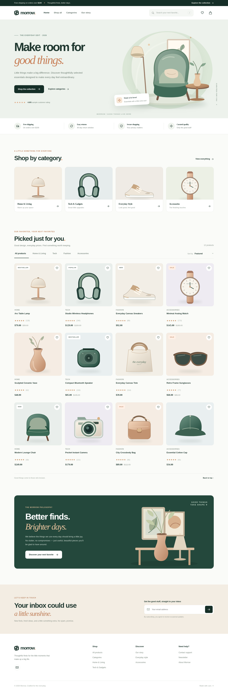
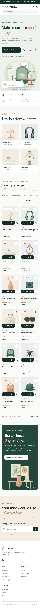

# Morrow — Modern E-commerce Storefront

A modern, responsive e-commerce storefront built with **plain HTML, CSS, and JavaScript**. Morrow features a clean editorial design, interactive product catalog, wishlist, shopping bag, product quick view, and responsive layouts for desktop, tablet, and mobile.

The project is a redesigned and repaired version of the original `.Store` sample, with improved accessibility, maintainable code, and a consistent design system.



## ✨ Features

- **Responsive design** — optimized for desktop, tablet, and mobile screens.
- **12 demo products** — organized into Home, Tech, Fashion, and Accessories.
- **Live product search** — search by product name, category, and description.
- **Category filters** — browse products by category.
- **Product sorting** — sort by featured products, price, and rating.
- **Wishlist** — add or remove favorites and filter the catalog to show saved items.
- **Shopping bag** — add products, remove items, update quantities, and calculate subtotals.
- **Free-shipping progress** — track progress toward the illustrative shipping threshold.
- **Product quick view** — inspect product details and add items to your bag.
- **Persistent browser storage** — cart and wishlist data are saved using `localStorage`.
- **Keyboard accessibility** — `/` focuses search, and `Escape` closes supported overlays.
- **Mobile navigation** — responsive navigation for smaller screens.
- **Local SVG illustrations** — bundled artwork without external image-hosting dependencies.
- **Reduced-motion support** — respects users' motion preferences.
- **Automated smoke tests** — Playwright tests cover important shopping flows and screen sizes.

## 🛠️ Built With

- **HTML5** — semantic page structure and accessible dialogs.
- **CSS3** — responsive layouts, custom properties, animations, and design system.
- **Vanilla JavaScript** — product rendering, filtering, sorting, cart state, and interactions.
- **SVG** — editable product and editorial illustrations.
- **LocalStorage API** — browser-side cart and wishlist persistence.
- **Python and Playwright** — automated browser smoke testing.

No frontend framework, package manager, or build step is required to run the storefront.

## 🌐 Live Demo

[**View Morrow — Modern E-commerce Storefront—> click me**](https://abu-salah-musha-lemon.github.io/E-commerce-website-html-css-js/)

Explore the responsive storefront, browse products, try the search and filters, manage your wishlist, and test the shopping bag.

**Author:** Abu Salah Musha Lemon


## 🚀 Getting Started

### Prerequisites

- A modern web browser.
- Python 3 (optional, for running a local server).
- Node.js (optional, for JavaScript syntax validation).

### 1\. Clone the repository

```
git clone https://github.com/Abu-Salah-Musha-Lemon/E-commerce-website-html-css-js.git

```

### 2\. Open the project directory

```
cd E-commerce-website-html-css-js
```

### 3\. Run the storefront

**Option A — Open directly**

Open `index.html` in your browser.

The storefront uses local files and does not require a build process. Depending on your browser's privacy settings, `localStorage` may behave differently when the page is opened through `file://`.

**Option B — Start a local server (recommended)**

Using Python:

```
python -m http.server 5500
```

Open the following address in your browser:

```
http://localhost:5500
```

**Option C — Use VS Code**

1. Open the project folder in Visual Studio Code.
2. Install the Live Server extension.
3. Right-click `index.html`.
4. Select **Open with Live Server**.

## 📁 Project Structure

```
E-commerce-website-html-css-js/
├── index.html
├── style.css
├── script.js
├── assets/
│   ├── hero-room.svg
│   ├── story-scene.svg
│   ├── lamp.svg
│   └── ... other SVG illustrations
├── docs/
│   └── CHANGES.md
├── tests/
│   ├── smoke_test.py
│   └── screenshots/
│       ├── desktop.png
│       └── mobile.png
├── legacy-original/
│   └── (v1.0.0)
└── README.md
```

## 🛍️ Product Catalog

The demo catalog is defined in the `PRODUCTS` array near the top of `script.js`.

Each product includes information such as its name, category, price, rating, illustration, and description.

Example:

```
{
  id: 'my-new-product',
  name: 'My New Product',
  category: 'Home',
  price: 49,
  originalPrice: 69,
  rating: 4.8,
  reviews: 20,
  image: 'assets/my-new-product.svg',
  color: 'sand',
  badge: 'New',
  description: 'A helpful description of this product.'
}
```

### Add a new product

1. Open `script.js`.
2. Add a product object to the `PRODUCTS` array.
3. Create or add an illustration inside `assets/`.
4. Set the correct relative image path.
5. Give the product a unique, stable `id`.

Supported categories are `Home`, `Tech`, `Fashion`, and `Accessories`.

If you introduce a new category, update the category filters and category tiles in `index.html` as well.

**Important:** Keep existing product IDs stable so saved cart and wishlist entries continue to reference the correct products.

## 🎨 Customization

### Branding and content

Edit `index.html` to customize:

- Store name and branding.
- Navigation links.
- Hero section and promotional content.
- Product and category sections.
- Editorial story section.
- Footer and contact information.

### Colors and design

Edit the CSS custom properties near the beginning of `style.css`.

Common variables include:

```
:root {
  --ink: /* primary text color */;
  --accent: /* brand accent color */;
  --paper: /* page background */;
  --border: /* border color */;
}
```

Keep the existing variable names when changing their values, since the stylesheet may reference them throughout the design.

### Typography

The storefront uses Manrope and DM Sans, with system-font fallbacks. External font availability may depend on your network connection.

### Responsive breakpoints

The stylesheet includes responsive breakpoints at:

- `1160px`
- `900px`
- `650px`
- `380px`

Adjust these in `style.css` to suit your preferred layouts.

### Currency and shipping

In `script.js`:

- Update the `money` formatter to change currency formatting.
- Update `SHIPPING_THRESHOLD` to change the free-shipping progress threshold.

Changing the currency symbol does not convert prices or calculate taxes.

## 🧪 Testing

### JavaScript syntax check

If Node.js is installed, run:

```
node --check script.js
```

### Browser smoke tests

Install Playwright for Python:

```
python -m pip install playwright
python -m playwright install chromium
```

Run the tests:

```
python tests/smoke_test.py
```

The smoke-test suite covers:

- Product catalog rendering and image loading.
- Live search and empty search results.
- Category filtering and sorting.
- Cart subtotal and quantity updates.
- Free-shipping progress.
- Cart and wishlist state restoration.
- Wishlist interactions.
- Product quick view.
- Newsletter form validation.
- Mobile navigation.
- Horizontal overflow at viewport widths of 320, 375, 390, 768, 1024, and 1440 pixels.

The test harness embeds the page assets for browser checks in restricted environments and uses an in-memory `localStorage` stand-in. The actual storefront uses the browser's native `localStorage`.

## 📸 Screenshots

**Desktop preview**


**Mobile preview**

\!Morrow Mobile Screenshot 

## ⚠️ Prototype Limitations

Morrow is a **frontend demonstration, not a production-ready commerce platform**.

The current implementation does not:

- Process payments or charge customers.
- Submit or persist real orders.
- Provide customer accounts or authentication.
- Maintain inventory through a backend.
- Calculate production taxes or validate prices server-side.
- Send newsletter subscriptions or transactional emails.

The product catalog, prices, ratings, reviews, shipping offers, and store policies are illustrative placeholders. Cart and wishlist persistence is browser-specific and does not synchronize across devices.

Before launching a real store, integrate:

1. A product catalog and inventory API.
2. A backend with persistent order storage.
3. Server-side validation for pricing, quantities, discounts, shipping, and taxes.
4. A trusted payment provider with hosted or otherwise appropriately secured payment processing.
5. Authentication, order tracking, and customer support.
6. A newsletter service with explicit consent and unsubscribe support.
7. Verified product images, legal policies, fulfillment details, and business contact information.

## 📝 Original Project and Changes

The original 2023 storefront is preserved under `legacy-original/(v1.0.0)` for comparison.

The redesigned implementation improves the original project with:

- A centralized product data array.
- Consistent styling and responsive layouts.
- Functional cart and wishlist state management.
- Improved search, filtering, and sorting.
- More complete mobile interactions.
- Accessible dialogs and keyboard interactions.
- Bundled SVG artwork.
- Automated browser smoke tests.

See `docs/CHANGES.md` for more details.

## 🤝 Contributing

Contributions, suggestions, and bug reports are welcome.

1. Fork the repository.
2. Create a feature branch.
3. Make your changes.
4. Test the storefront at desktop and mobile viewport sizes.
5. Submit a pull request describing your changes.

## 📄 License

No license has been specified for this project yet. Add a `LICENSE` file before explicitly granting others permission to use, modify, or redistribute the code.

---

**Morrow** — Thoughtful design. Everyday essentials.

## 👨‍💻 Author

**Abu Salah Musha Lemon**

- GitHub: @abu-salah-musha-lemon

Built with ❤️ using HTML, CSS, and JavaScript.
